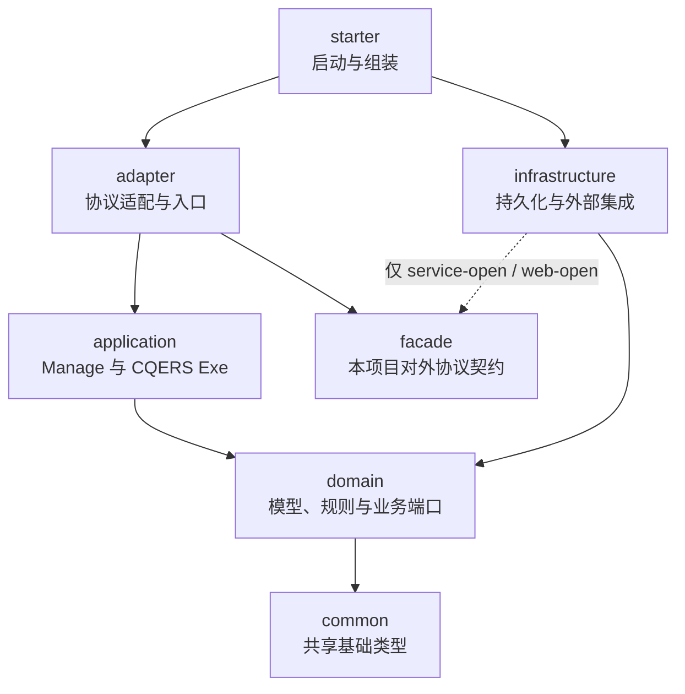
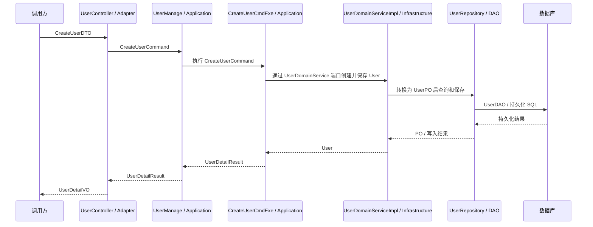

# Stellar-Enclosure-COLA

Application architecture templates, Maven archetypes and coding workflow skills for Stellar Enclosure. All first-party modules start at **0.0.1**.

## 功能概览

| 能力 | 当前实现与入口 |
|---|---|
| 轻量业务工程 | `light`、`light-open` 为单 Maven 模块，按业务域组织包，适合不需要拆分部署模块的应用。 |
| 服务工程 | `service`、`service-open` 提供七模块工程，包含独立 Facade 合同和 RPC/MQ 适配；不承担业务 HTTP Controller。 |
| Web 工程 | `web`、`web-open` 提供七模块工程，包含 HTTP/GraphQL/RPC/MQ 入口与跨服务调用示例。 |
| Agent 工程 | `agent` 提供六模块工程，包含 Deep Research SSE、Knowledge API、Agent Flow、RAG 和 Outbox 集成。 |
| Archetype 生产 | 从正常源工程与打包定义生成七族 archetype，支持确定性检查、边界检查与生成工程的 Groovy verifier。 |
| 编码工作流 | `.agents/skills/stellar-enclosure-coding-*` 提供建模块、需求规格、实施计划和执行计划四个技能；Spec/Plan/Execute 内置离线 CRUD codegen 启动脚本。 |

Native 与 Open 是已有集成边界不同的工程族，具体协议和依赖以所选源工程为准。模板与组件库分别维护：本仓库拥有源工程、打包规则和技能，实际通用运行时能力来自 [Components](https://github.com/Stellar-Enclosure/Stellar-Enclosure-Components) 及各平台 Starter。生成成功只证明模板打包与检查结果；现有实现与目标编码规范的差异见[架构总览](docs/architecture-overview.md)和[编码规范](docs/coding-standard.md)。

Components 中独立维护的 code generator 支持 native Light、Web 和 Service 的 CQERS 执行器、按命令映射或委托业务端口的入站事件；独立事件可不依赖 DDL。生成领域端口和 HTTP 入口时须显式提供业务方法、权限及字段资源契约；Agent 和 Open 工程仍不在其生成范围内。旧版生成文件的迁移须保留所有权与冲突保护。详情见 [CQERS 架构](docs/cqers-architecture.md#兼容与验证)。

## COLA 架构

业务代码按领域和职责组织，Domain 持有业务模型及所需端口，Infrastructure 实现这些端口。Application 的 Manage 保留用例入口，每个 Command、Query 和需要消费的业务 Event 交给对应的 Exe 执行。Adapter 负责接入协议，Starter 负责组装；消息发布的具体实现位于 Infrastructure。

本项目将这种按 Command、Query 和 Event 划分执行责任的方式称为 **CQERS（Command–Query–Event Responsibility Segregation）**。它是在 CQRS 思路上明确事件处理职责的项目约定，不要求事件溯源、独立数据库或额外的消息总线。

### 模块依赖图

以下以 `service`、`service-open`、`web` 和 `web-open` 为例，箭头表示 **Maven 模块直接依赖的方向**；图中不包含外部组件或对端 Facade：



- `light`、`light-open` 是单 Maven 模块：上述职责体现为同一工程内的包，启动包名为 `start`，`facade` 也是包而不是独立模块。
- `agent` 是六模块：`common`、`domain`、`application`、`infrastructure`、`adapter`、`starter`，没有独立 `facade` 模块。Agent 领域模型和持久化端口的具体目录与其他工程不同，见下表。
- `service` 系列不提供业务 HTTP Controller；`web` 系列提供 HTTP/GraphQL 等入口。Native、Open 及可选的对端 Facade 集成以各自 POM 和源码为准。
- Adapter 不直接依赖 Infrastructure；Domain 不依赖 Infrastructure 的 PO、DAO 或具体 Repository。单模块也保持相应的包职责。图中的依赖方向与运行时调用方向不同。

### 典型运行调用

以 `web` 源工程创建用户为例，箭头表示 **运行时调用或返回**；持久化实现通过 Domain 端口注入，不能据此理解为 Domain 模块依赖 Infrastructure：



这是一个具体链路，不表示所有操作都需要上述全部对象。Query 应只读；Command 的事务、并发与幂等按用例确定。收到的业务事件由 Adapter 转为事件对象，再交给对应 `EventExe`；出站事件通过 Domain 端口交给 Infrastructure 发布，不由 `EventExe` 发布。事件可使用事务 Outbox 或实际 MQ，但需分别说明投递和失败处理；现有 Web 的 after-commit 消息发布不等于事务 Outbox。

源码入口：[UserController](source-projects/stellar-enclosure-source-web/stellar-enclosure-source-web-adapter/src/main/java/top/egon/cola/archetype/source/web/adapter/user/controller/UserController.java)、[UserManageImpl](source-projects/stellar-enclosure-source-web/stellar-enclosure-source-web-application/src/main/java/top/egon/cola/archetype/source/web/application/user/manage/impl/UserManageImpl.java)、[CreateUserCmdExe](source-projects/stellar-enclosure-source-web/stellar-enclosure-source-web-application/src/main/java/top/egon/cola/archetype/source/web/application/user/executor/command/CreateUserCmdExe.java)、[UserDomainServiceImpl](source-projects/stellar-enclosure-source-web/stellar-enclosure-source-web-infrastructure/src/main/java/top/egon/cola/archetype/source/web/infrastructure/user/service/impl/UserDomainServiceImpl.java)。Agent 的端口示例见 [KnowledgeBaseRepository](source-projects/stellar-enclosure-source-agent/stellar-enclosure-source-agent-domain/src/main/java/top/egon/cola/archetype/source/agent/domain/knowledge/repository/KnowledgeBaseRepository.java)。

## 类命名与位置规范

下表的 `Xxx` 是业务或职责名称，`<业务域>` 如 `user`、`teaching`、`knowledge`。位置是 **Java 基础包之后的相对包路径**，例如 Web 源工程的基础包是 `top.egon.cola.archetype.source.web`。多模块工程中的 `application/user/...` 对应 `stellar-enclosure-source-web-application/src/main/java/top/egon/cola/archetype/source/web/application/user/...`；Light 对应同一工程的 `src/main/java/.../application/user/...`。生成工程的基础包以生成参数为准。

表格以现有类和目录为例，并说明新增或修改代码的目标约定；并非要求给每个业务生成所有类型。已有公开契约、类名和目录应兼容，不能仅为统一后缀而改名。源码中仍有部分普通 DTO/Command/Result 使用 `record` 等历史差异，不代表已符合当前[编码规范](docs/coding-standard.md#当前实现与目标规范的差异)。

### Adapter 与 Facade：协议和入口

| 规范 | 位置 | 用途 | 解释 |
|---|---|---|---|
| `XxxController` | `adapter/<业务域>/controller/` | HTTP 入口 | 接收请求、执行边界校验及协议转换，调用 Application；如 `UserController`。Service 系列不设业务 HTTP Controller。 |
| `XxxResolver` | `adapter/<业务域>/graphql/` | GraphQL 入口 | 绑定 GraphQL 操作并调用用例，如 `UserResolver`。 |
| `XxxConsumer` | `adapter/<业务域>/mq/` | 消息消费入口 | 接收和校验消息、调用用例；按消息契约处理重试与幂等，如 `UserCreatedConsumer`。 |
| `XxxEventHandler` | `adapter/<业务域>/event/` | 入站事件适配入口 | code generator 可按显式事件配置生成，委托对应 EventExe；实际队列订阅、来源校验和确认仍由调用方接线。 |
| `XxxJob` / `XxxScheduler` | 归属 `adapter/<业务域>/`；具体子包按所选产品已有结构确定 | 定时任务入口 | 触发任务并调用用例；当前源工程未统一提供 Job 或 Scheduler 目录，不预设已生成此类。 |
| `XxxFacade`、`XxxFacadeImpl` / `XxxRpcProvider` | 契约在 `facade/<业务域>/`；实现在 `adapter/<业务域>/facade/impl/` 或 `adapter/<业务域>/rpc/` | RPC 契约及入站实现 | Native 示例为 `UserFacade` / `UserFacadeImpl`；Open 示例为 `UserRpcProvider`。具体契约以所选产品的 Java 接口或 Protobuf 为准。 |
| `*.proto` 及生成的协议类 | Service/Web 的 Facade 模块 `src/main/proto/`；Light Native 在单模块 `src/main/proto/` | 协议定义 | 生成的 `*Request` / `*Response` 遵循既有 Protobuf 契约；Light Open 现有 Facade 使用 Java 契约，Agent 无独立 Facade。 |
| `XxxDTO`、`XxxMessage` | `adapter/<业务域>/pojo/dto/`；Light 的 Facade 契约可在 `facade/<业务域>/dto/` | 协议数据与消息载体 | DTO 表达传输边界，如 `CreateUserDTO`；消息载体如 `CreateUserMessage`，按实际协议区分命令与事件。 |
| `XxxVO` | `adapter/<业务域>/pojo/vo/` | 展示对象 | 面向调用方的 View Object，如 `UserDetailVO`；它与 Domain 的值对象不是同一含义。 |
| `XxxAdapterConverter` / 既有 `XxxAdapterConvertor` | `adapter/<业务域>/pojo/convertor/` | 协议对象转换 | 例如 DTO → Command、Result → VO；Light 现有类和包保留 `Convertor` 拼写，勿为统一拼写破坏兼容。 |
| `XxxRequestValidator` / `XxxFacadeValidator` | `adapter/<业务域>/validators/` | 协议边界校验 | 如 Light 的 `UserRequestValidator`；按入口激活约束及分组，不以此代替应用和领域边界的校验。 |
| `XxxFilter`、`XxxInterceptor` | `adapter/filter/`、`adapter/graphql/` 等实际协议入口包 | 横切请求处理 | 用于协议相关的身份上下文、跟踪或拦截；不代替领域规则，如 `OrganizationTraceFilter`。 |
| `XxxExceptionHandler` / `XxxExceptionResolver` | `adapter/handler/` 或相应业务域的 `handler/` | 错误映射 | 将应用及领域错误映射为对应协议错误，如 `OrganizationGlobalExceptionHandler`。 |

### Application：用例编排

| 规范 | 位置 | 用途 | 解释 |
|---|---|---|---|
| `XxxManage`、`XxxManageImpl` | `application/<业务域>/manage/`、`manage/impl/` | 用例入口 | 例如 `UserManage` / `UserManageImpl`；保留已有接口和事务入口，将具体执行交给对应 Exe，不直接操作 Infrastructure 的 PO/DAO。 |
| 业务语义的 `XxxService` | `application/<业务域>/service/` | 用例内的应用服务 | 如 Agent 的 `KnowledgeIngestQueueService`；只在存在独立的应用职责时使用，不为简单转发增加一层。 |
| `XxxCommand` | `application/<业务域>/pojo/command/` | 写入意图 | 表达状态变更，如 `CreateUserCommand`；明确校验、事务、幂等及失败语义。 |
| `XxxQuery`、`XxxPageQuery` | `application/<业务域>/pojo/query/` | 查询意图 | 如 `UserDetailQuery`；Query 不隐藏业务写入或业务事件发布，分页沿用已有契约。 |
| `XxxEvent` | `application/<业务域>/pojo/event/` | 已接收的业务事件 | 如 Light 的 `UserImportedEvent`；与用于协议传输的消息 DTO 分开，转交给匹配的 EventExe。 |
| `XxxCmdExe` | `application/<业务域>/executor/command/` | 执行 Command | `CreateUserCommand` 对应 `CreateUserCmdExe`；负责该写用例的业务编排，事务和幂等边界按现有用例确定。 |
| `XxxQueryExe` | `application/<业务域>/executor/query/` | 执行 Query | `UserDetailQuery` 对应 `UserDetailQueryExe`；只读并返回 Result 或已有业务结果。 |
| `XxxEventExe` | `application/<业务域>/executor/event/` | 处理收到的业务事件 | `UserImportedEvent` 对应 `UserImportedEventExe`；消费后的业务处理可调用现有 Command 用例，幂等与重试仍按消费契约处理。 |
| `XxxResult`、`XxxPageResult` | `application/<业务域>/pojo/result/` | 用例结果 | 如 `UserDetailResult`；仅在需要稳定结果边界时定义。Agent 现有用例也会返回 Domain 的 `KnowledgeBaseBO`。 |
| `XxxApplicationConverter` / `XxxConverter` | `application/<业务域>/pojo/convertor/` | 用例数据转换 | 如 `UserConverter` 将领域模型投影为 Result。新增跨层转换复用 MapStruct/MapStructPlus 与 Common `BaseConverter` / `BaseForwardConverter`。 |
| `XxxApplicationValidator` | `application/<业务域>/validators/` | 用例边界校验 | 如 `UserApplicationValidator`；新增校验优先使用 Jakarta 约束、`@Valid` / `@Validated` 和必要分组，数据库状态类业务不变量由所属领域和事务负责。 |

### Domain：领域模型与端口

| 规范 | 位置 | 用途 | 解释 |
|---|---|---|---|
| `Xxx` / `XxxEntity` | `domain/<业务域>/entities/` | 领域实体 | 具有业务身份和生命周期，如现有 `User`；`Entity` 仅用于真实实体语义，已有无后缀类不强制改名。 |
| `XxxAggregate` | `domain/<业务域>/aggregates/` | 聚合 | 组织需要共同维护不变量的实体和值对象，如 `UserAggregate`；不因分层而机械创建。 |
| 语义化值对象，如 `XxxId`、`XxxCode` | `domain/<业务域>/vos/` | 领域值对象 | 如 `UserId`、`RoleCode`；名称体现领域含义，维护值语义及不变量，不能与 Adapter 的展示 `VO` 混淆。 |
| `XxxBO` | 按所属业务放在领域或用例包；Agent 示例为 `domain/<业务域>/model/` | 业务数据载体 | 如 `KnowledgeBaseBO`；只在确有业务语义或边界差异时引入，不按层复制同一组字段。 |
| `XxxDomainService` / 业务语义的 `XxxService` | `domain/<业务域>/service/`，共享端口可在 `domain/service/` | 领域行为及业务端口 | 如 `UserDomainService`；涉及外部能力时由 Domain 定义业务语义，Infrastructure 提供实现，不继承技术 CRUD 接口。 |
| `XxxRepository` 接口 | Agent 示例：`domain/<业务域>/repository/` | 领域持久化端口 | 如 Agent 的 `KnowledgeBaseRepository`；它声明业务操作，不能暴露 PO/DAO。其他产品现有业务端口常命名为 `XxxDomainService`。 |
| `XxxEvent` | 通常在 `domain/<业务域>/events/`；Light/Agent 的既有模型也位于 `vos/` / `model/` | 事件模型 | 业务事件如 `UserChangedEvent` 表达已发生的事实；定义事件类不保证可靠投递。Agent 的 SSE 流事件需单独分类。 |
| 业务枚举，如 `XxxStatus`、`XxxType` | `domain/<业务域>/enums/`；Agent 既有模型在 `model/` | 领域状态与类型 | 如 `UserStatus`；涉及持久化编码时使用 `@EnumValue`，对外 JSON 标量使用 `@JsonValue`，并考虑编码兼容。 |
| `XxxDomainValidator` | `domain/<业务域>/validators/` | 领域校验 | 如 `UserDomainValidator`；维护领域约束，必要时与自定义 `@Constraint` / `ConstraintValidator` 配合。 |

### Infrastructure：持久化与外部能力

| 规范 | 位置 | 用途 | 解释 |
|---|---|---|---|
| `XxxDomainServiceImpl` / `XxxRepositoryImpl` | `infrastructure/<业务域>/service/impl/`；Agent 的 Repository 实现在 `infrastructure/<业务域>/service/` | Domain 端口实现 | 如 `UserDomainServiceImpl`、Agent 的 `KnowledgeBaseRepositoryImpl`；连接持久化或外部能力并返回领域类型。 |
| `XxxPO` | `infrastructure/<业务域>/po/` | 持久化对象 | 如 `UserPO`，对应持久化数据，复用 `EgonModel`；PO 不作为对外协议或 Domain 端口类型。 |
| `XxxRepository` | `infrastructure/<业务域>/repo/` | 具体持久化 Repository | Light/Service/Web 如 `UserRepository`，继承 `EgonColaRepository`；Agent 使用其领域 `XxxRepository` 端口和 Infrastructure 的 `XxxRepositoryImpl`。 |
| `XxxDAO` | `infrastructure/<业务域>/dao/` | 数据访问组件 | 如 `UserDAO`，继承 `EgonColaMapper`；DAO 是访问组件，不是数据对象。 |
| `XxxDAO.xml` | 对应 Infrastructure 模块的 `src/main/resources/mybatis/mapper/<业务域>/`；Light 在单模块资源目录 | 显式 SQL | 如 `UserDAO.xml`；查询须考虑租户、有效行和路由条件，自定义写入还须核对版本和业务前态。 |
| `XxxPOConverter` | `infrastructure/<业务域>/converter/` | 领域对象与 PO 转换 | 如 `UserPOConverter`；`dao`、`po`、`converter`、`repo` 在业务域下平级。 |
| `XxxClient`、`XxxClientImpl` | `infrastructure/<业务域>/client/` 或已有 `infrastructure/client/<系统>/` | 出站客户端 | 调用外部系统或对端 Facade，如 `EvaluationQueryClient`；领域侧通过业务端口隔离协议细节。 |
| `XxxProducer`、`XxxMessageService` | `infrastructure/mq/` 及其 `impl/` | 出站消息适配 | 如 `OrganizationEventProducer`；需明确投递确认、事务与失败恢复，不把普通 MQ 发布描述为 Outbox。 |

### 共享与装配

| 规范 | 位置 | 用途 | 解释 |
|---|---|---|---|
| `XxxException`、错误码枚举 / 常量 | `common/exception/`、`common/enums/`、`common/constants/` | 跨层共享错误与基础类型 | 如 `OrganizationApplicationException`；只放确需共享的类型，协议错误映射仍由 Adapter 负责。 |
| `XxxConfig` / `XxxConfiguration`、`XxxProperties` | 所属层的 `config/`，启动组装位于 `starter/config/` 或 Light 的 `start/config/` | 配置和装配 | 例如 `OrganizationRedisConfig`、`OrganizationJacksonConfig`；配置归属于实际拥有该能力的层。 |
| `XxxAspect` | 对应横切能力所在层，如 `infrastructure/aop/` | 切面 | 如 `InfrastructureLogAspect`；不替代业务异常处理或事务设计。 |
| `XxxApplication` | `starter/`；Light 为 `start/` | 启动入口 | 如 `OrganizationApplication`、`StudentManagementApplication`；负责组合层与配置。 |
| `XxxTest` | 对应模块的 `src/test/java/` | 验证 | 测试对应层的业务、边界和失败行为；架构约束按所选模板的测试及配置执行。 |

### 与参考图中命名的对应关系

| 规范 | 位置 | 用途 | 解释 |
|---|---|---|---|
| `XxxCO`、`XxxCmd` | 分别对应 Adapter / Facade 的 DTO、Application 的 Command | 传输对象、写入意图 | 本项目使用 `XxxDTO`、`XxxCommand` 等语义命名，不要求新建 CO 或 Cmd 的同义类。 |
| `XxxCmdExe`、`XxxQueryExe`、`XxxEventExe` | `application/<业务域>/executor/command/`、`query/`、`event/` | 执行命令、查询及收到的业务事件 | 每种应用输入对应一个执行器；Manage 保留入口，具体业务逻辑由 Exe 执行。 |
| `XxxDO`、`XxxTunnel` | `infrastructure/<业务域>/po/`、`dao/` 和 `repo/` | 持久化数据与访问 | 本项目使用 `XxxPO`、`XxxDAO`、`XxxRepository`；不要新增含义重叠的 DO 或 Tunnel。 |
| `XxxAssembler`、`XxxConvertor` | 各层现有 `pojo/convertor/` 或 `converter/` | 对象转换 | 使用各层职责明确的 Converter；`convertor` 是部分现有包及类的拼写，不额外要求 Assembler。 |
| `XxxGateway` | 领域端口及其 Infrastructure 实现所在包 | 外部能力边界 | 使用现有业务语义的 Service 或 Agent Repository 端口；不新增通用 Gateway 层。 |
| `XxxFactory`、`XxxRule`、`XxxExtPt` / `XxxExt` | 按所属领域及现有产品结构放置 | 构造、规则或扩展点 | 只在确有复杂构造、可变化规则或明确扩展需求时使用；参考图不意味着模板统一提供这些类或目录。 |

出站 Domain Event 是已发生的业务事实，不因声明了事件类型就创建空的 EventExe；只有本服务实际消费的业务事件才需要对应处理器。Agent 的研究和问答 SSE 事件是流输出，不当作消息消费事件。现有 `RetrieveKnowledgeCommand` 虽有 Command 后缀，仍是只读检索；其名称与接口为兼容保留。

## Build

Requires Java 25 and the included Maven Wrapper. The shared parent manages Spring Boot 4.1.2. Once the 0.0.1 dependencies are published:

```bash
./mvnw -B -ntp test-compile
```

Before the first Central publication, clone the eight Java repositories next to one another and bootstrap their artifact graph explicitly:

```bash
bash ../Stellar-Enclosure-Parent/scripts/bootstrap-workspace.sh \
  --workspace "$(cd .. && pwd)" \
  --local-repository "$HOME/.m2/repository"

# Resolve subsequent Maven commands and generator subprocesses from this same cache.
export MAVEN_ARGS="${MAVEN_ARGS:-} -Dmaven.repo.local=$HOME/.m2/repository"
```

The bootstrap installs parent/BOM models before building components and business starters in Maven reactor order. It compiles test sources and installs packages with runtime tests disabled. It never runs applications, databases, containers, browsers, or deploy.

## Skills and archetypes

The four skills are under `.agents/skills/stellar-enclosure-coding-*`. Their resources and original normative rule blocks remain included. `.agents/skills/scripts/link-skills.sh` supports explicit links to other checkouts; its regression test is beside it.

Seven authoritative archetype families live under `source-projects` and `definitions`. Never edit or commit `.generated`. After bootstrap:

```bash
./scripts/generate_archetypes.sh generate
./scripts/generate_archetypes.sh check
```

The Spec, Plan and Execute skills each bundle `scripts/stellar-enclosure-codegen.sh` inside their own skill directory. Invoke it from the resolved skill root so it also works in linked or copied skills. Its implementation is the Components artifact `top.egon:stellar-enclosure-component-code-generator:0.0.1`; the existing explicit `EGON_CODEGEN_CLASSPATH` contract is preserved.

本仓库维护七个 Maven Archetype 产品：可直接编译、测试的正常源工程经两段式生成，打包成发布到 Maven Central 的 archetype。根 `pom.xml` 是 `stellar-enclosure-archetypes-parent`，直接继承 `stellar-enclosure-parent`。`source-projects/`、`definitions/`、`docs/` 和 `.generated/` 均位于仓库根目录。

## 目录结构

| 路径 | 内容 | 是否手改 |
|---|---|---|
| `source-projects/stellar-enclosure-source-<family>/` | 七个正常源工程：Java、资源、测试、模块 POM，以及随生成工程分发的 README | 是，这里是事实来源 |
| `definitions/stellar-enclosure-archetype-<family>/` | archetype 打包描述、`verify.groovy` 集成测试、随生成工程分发的策展文档 | 是 |
| `.generated/` | 由 `scripts/generate_archetypes.sh generate` 派生的打包输入，已被 gitignore | 否，永远不要手改 |
| `docs/` | 维护者文档（见下文），不随生成工程分发 | 是 |

七个 family 为 `light`、`light-open`、`service`、`service-open`、`web`、`web-open`、`agent`。各产品的形态、模块与直接依赖见[架构总览](docs/architecture-overview.md)。

## 维护者文档

| 文档 | 语言 | 内容 |
|---|---|---|
| [docs/architecture-overview.md](docs/architecture-overview.md) | English | 七个产品的形态选择、实际直接模块依赖、层职责、持久化与验证边界 |
| [docs/architecture-diagrams.md](docs/architecture-diagrams.md) | 中文 | 业务层依赖、持久化调用、CQE 事务事件、数据库生命周期四张 Mermaid 图 |
| [docs/cqers-architecture.md](docs/cqers-architecture.md) | 中文 | Command、Query、Event 执行器命名、位置、调用与事务边界 |
| [docs/coding-standard.md](docs/coding-standard.md) | 中文 | Java、组件复用、校验、软删除唯一键、分布式 DDL 与 CQE 的目标编码规范，以及当前实现与规范的已知差异 |
| [docs/open-archetype-code-style.md](docs/open-archetype-code-style.md) | English | 三个 Open 产品在通用编码规范之外的补充约定 |
| [docs/generated-readme-contract.md](docs/generated-readme-contract.md) | 中文 | 生成工程 README 的统一章节骨架，以及被 `verify.groovy` 断言冻结、改文档时必须保留的子串 |

## 会离开本目录的文档

下列文件不只给本仓库维护者看，修改时要按读者和去向来写：

| 来源 | 去向 | 读者 |
|---|---|---|
| `source-projects/*/README.md`、`README.zh-CN.md` | 生成业务工程的根目录 README，`${rootArtifactId}` 等变量被替换 | 业务工程开发者 |
| `source-projects/*/deploy/container/README.md` | 生成业务工程的容器交付说明（不做 Velocity 转义） | 业务工程开发者 |
| `source-projects/*/**/db/manual/postgresql/README.md` | 生成业务工程的归档 SQL 说明（仅 Open 族） | 业务工程开发者 |
| `definitions/*/src/main/javadoc/README.md` | 打进 archetype 发布制品的 javadoc classifier | archetype 使用者 |
| `definitions/*/architecture-docs/architecture.md` | 复制到 `.generated/` 中 archetype 目录旁，供 `verify.groovy` 读取；**不进入**生成业务工程，也不在发布制品里 | 维护者、集成测试 |

修改前三类文件前先读 [docs/generated-readme-contract.md](docs/generated-readme-contract.md)：README 有统一的章节骨架，且大量子串被集成测试逐字断言，改错一个字就会让 archetype IT 失败。`architecture.md` 同样有被断言的关键字，见该文档最后一节。

## 修改与验证

改源工程或策展文档后，按顺序运行：

```bash
./scripts/generate_archetypes.sh generate
```

```bash
./scripts/generate_archetypes.sh check
```

```bash
python3 scripts/checks/check-archetype-family-boundaries.py
```

```bash
python3 scripts/checks/check-native-archetype-boundaries.py
```

```bash
./mvnw -o -f pom.xml -Pgenerated-archetypes integration-test -DskipTests=false
```

最后一条会为七族各生成一个业务工程并运行其 `verify.groovy`，耗时较长；只改动单个 family 时可加 `-pl :stellar-enclosure-archetype-<family>` 限定范围。生成器和静态检查通过不代表应用、数据库或容器运行验证通过。

`scripts/` 只保留 archetype 维护工具：`generate_archetypes.sh` 生成并检查打包资源，`checks/` 校验 Native/Open/Agent 边界，`regression/` 验证生成器安全性及 Groovy verifier。生成器回归使用 `bash scripts/regression/test-generate-archetypes.sh unit`；两个 verifier 回归脚本需要显式传入已构建的生成工程和 Groovy classpath，可用 `--help` 查看参数。

## Publish to Maven Central

This repository publishes its root archetype parent, seven generated archetypes and four peer facade contracts needed by generated projects. The generated reactor wrapper and all other source-project examples are excluded. Dependencies from Parent, Components and the platform Starters must already be published.

Configure Maven server `central` with your Central Portal token and a local GPG key, as described in the [release guide](https://github.com/Stellar-Enclosure/Stellar-Enclosure-Parent/blob/main/docs/first-release.md). Run from this repository:

```bash
(
set -e
./scripts/generate_archetypes.sh generate
./scripts/generate_archetypes.sh check

# Publish the parent once. It must retain its dependency/plugin management.
./mvnw -B -ntp -N -f pom.xml -Prelease clean deploy

# Only the four facade contracts use flattened consumer POMs.
for family in service web service-open web-open; do
  ./mvnw -B -ntp \
    -f "source-projects/stellar-enclosure-source-${family}/stellar-enclosure-source-${family}-facade/pom.xml" \
    -Prelease,publish-resolved-facade clean deploy
done

# Select the seven archetypes without publishing the parent/facades again.
./mvnw -B -ntp -f pom.xml \
  -Prelease,generated-archetypes \
  -pl :stellar-enclosure-archetype-agent,:stellar-enclosure-archetype-light,:stellar-enclosure-archetype-light-open,:stellar-enclosure-archetype-service,:stellar-enclosure-archetype-service-open,:stellar-enclosure-archetype-web,:stellar-enclosure-archetype-web-open \
  -Darchetype.test.skip=true clean deploy
)
```

For a local release rehearsal, run the same Maven commands with `verify` in place of `deploy` and add `-Dgpg.skip=true`; use the Build section's bootstrap if dependencies are not yet published. Keep `publish-resolved-facade` limited to the facade commands: flattening the parent would remove management required by its consumers. Stop on any failed publication, check which GAVs reached Central, and publish only the remaining modules or use a new version. Generated output stays ignored by Git. Pushes do not publish.

## Compatibility and publication

Java packages/classes, Bean names, configuration keys, OAuth/RPC identities, APIs, and database ownership are retained. Existing SQL and DDL history are copied byte for byte. Artifact/build versions and necessary build paths change. A successful build does not imply application startup or live infrastructure acceptance.

Git pushes run validation only. Central and npm publication are separate user actions. CI defaults to initial source bootstrap; after publication set `STELLAR_USE_SOURCE_BOOTSTRAP=false` to consume published artifacts directly. Private organizations may supply the Actions secret `STELLAR_ENCLOSURE_READ_TOKEN` with repository read access.

Original MIT/LGPL licenses and author attribution are preserved.
